# Mission Control

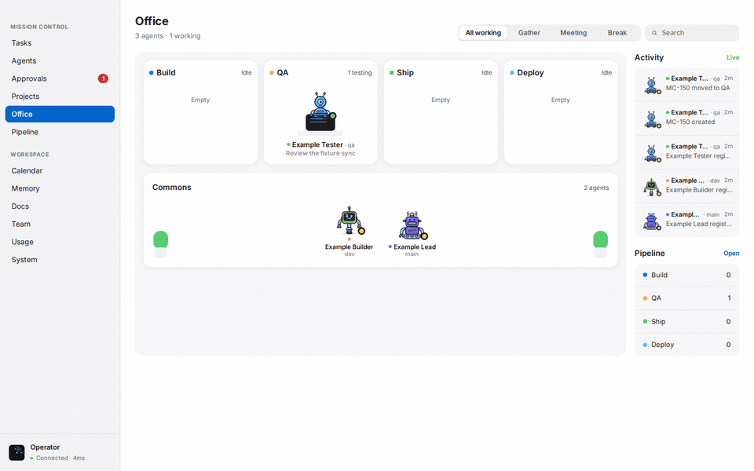

You host this command center yourself.

It shows tasks, an office floor, approvals, and spend for the agents on your machine.

OpenClaw is optional, and one command starts the dashboard.

```bash
curl -fsSL https://raw.githubusercontent.com/jaysinghcodes/Mission-Control/main/install.sh | bash
```

Then open the URL the script prints. The default is **http://localhost:5173/#/tasks**.

The clip above is five frames from one local run of the API and the web app. `bridge/mc-bridge-sync.py` read fixture JSON, because this machine has no OpenClaw install. The stills and the captions are in [Screenshots](#screenshots).

## Works with any provider

The dashboard does not pick a vendor. The bridge reports the provider and model OpenClaw is already using, and System prints that id. You do not need an account with any provider to install or to run `npm run seed:demo`.

| Provider id | Name on System | Spend |
| --- | --- | --- |
| `openai` | OpenAI | Tokens times `config/prices.json` |
| `anthropic` | Anthropic | Tokens times `config/prices.json` |
| `google` or `gemini` | Gemini | Tokens times `config/prices.json` |
| `deepseek` | DeepSeek | Tokens times `config/prices.json` |
| `openrouter` | OpenRouter | Tokens times `config/prices.json` |
| `ollama` | Ollama | $0.00. Local. |
| Any other id | The id the bridge sent | `Price not set` until you add a row |

A reported `costUsd` wins, including 0. A provider marked local is $0.00. `config/prices.local.json` is gitignored and merged on each read, so a price edit does not need a rebuild. The field tables are in [docs/API.md](docs/API.md#47-models-and-spend).

**Security.** Login is required when the caller is not on loopback. Compose always asks, because the API sees the Docker network. The installer prints the password once. SSH uses the owner port (default 5173). Cloudflare Tunnel and Tailscale Serve use tunnel port 3011 (`MC_REMOTE_PORT`). The laptop steps are in [docs/REMOTE.md](docs/REMOTE.md). Agent ingest still uses the `x-ingest-token` header when `INGEST_TOKEN` is set. That split is issue 36. The long note is [docs/SECURITY.md](docs/SECURITY.md).

## Screenshots

1440 by 900, light theme. The GIF at the top is a smaller copy of five of these frames.

This machine has no OpenClaw install. The bridge read JSON fixtures and posted them to the API. Captions name the file. Nothing here is a live gateway.

| Office, one registered bot in QA | Tasks, the same ticket |
| --- | --- |
| 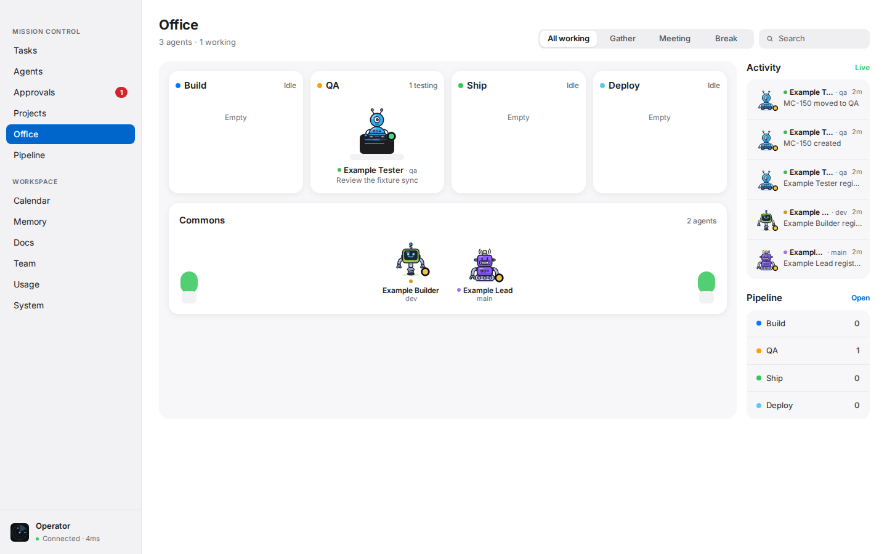 | 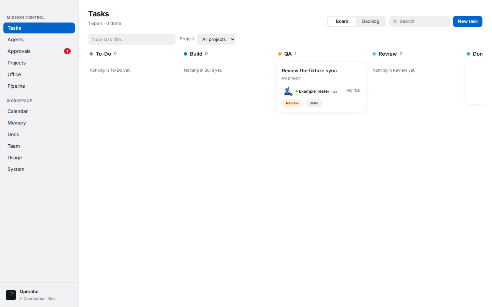 |

Example Tester, Example Builder, and Example Lead were registered from `bridge/examples/agents.json`. The QA seat is ticket MC-150. It was created with POST /tickets and then moved to QA. Example Builder and Example Lead have no active ticket, so they sit in Commons. The Tasks board is that same ticket.

| Providers from the models fixture | Gateway down, no OpenClaw process |
| --- | --- |
| 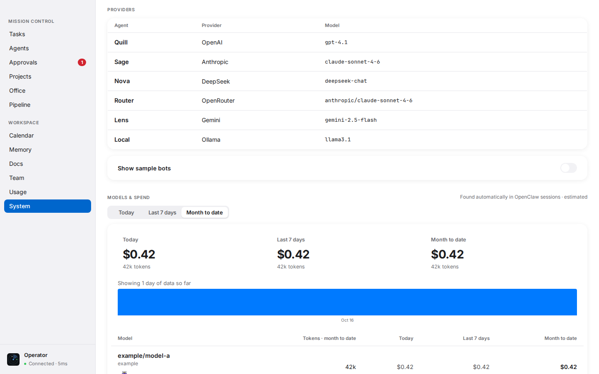 | 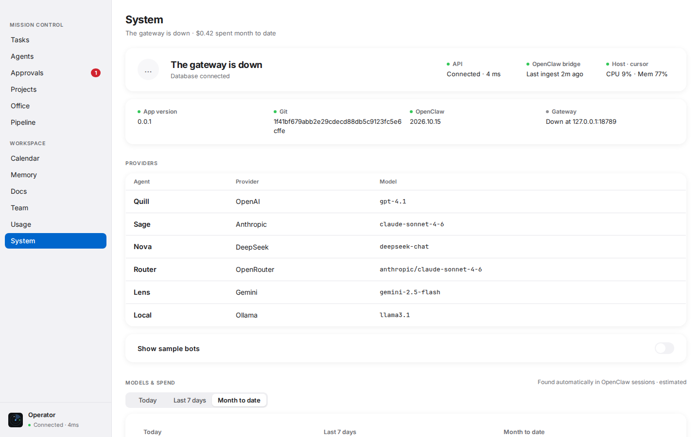 |

The provider rows are `bridge/examples/models/openclaw.json`. Quill, Sage, Nova, Router, Lens, and Local are names in that file. They are not connected accounts. Ollama is marked local. On the same run the gateway probe to `127.0.0.1:18789` was down, because nothing was listening. The bridge chip stays not connected until a sync timestamp is fresh.

| Approvals from fresh-install | Devices from fresh-install |
| --- | --- |
| 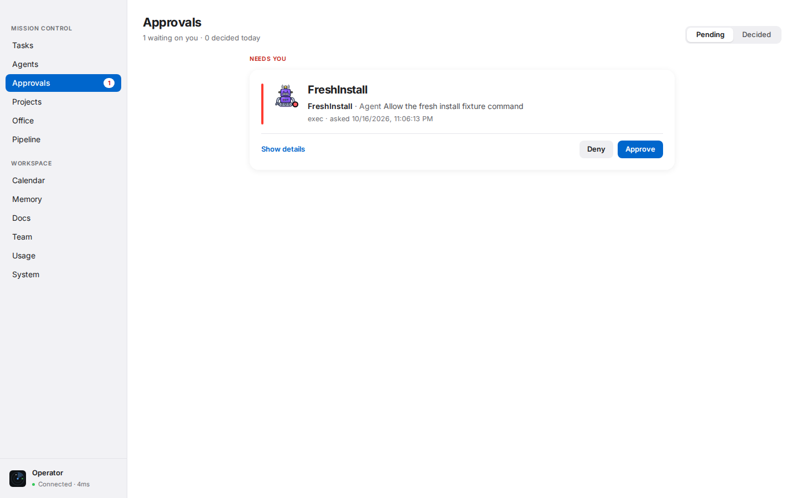 | 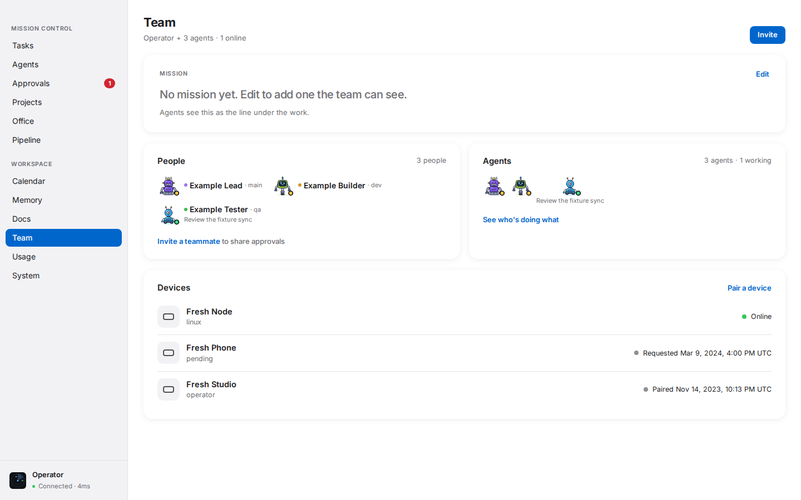 |

The pending approval and the three devices are `bridge/examples/fresh-install`. The tag is FreshInstall. Fresh Studio, Fresh Phone, and Fresh Node are fixture names. The dates are the timestamps in that JSON. That directory is the fixture the installer CI posts.

| Sessions from the sessions fixture | Calendar from the cron fixture |
| --- | --- |
| 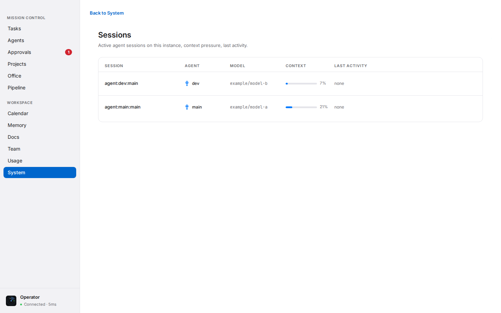 | 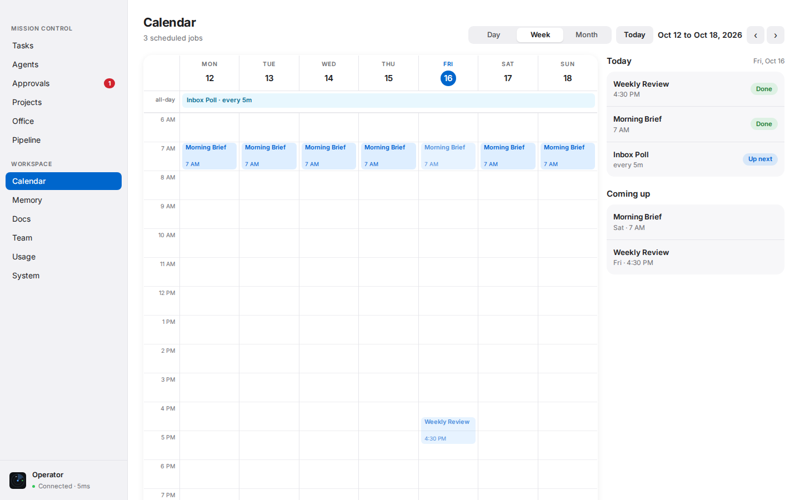 |

Sessions are `bridge/examples/sessions.json`. The model ids are `example/model-a` and `example/model-b`. Calendar jobs are `bridge/examples/cron.json`: Morning Brief, Weekly Review, and Inbox Poll.

### Sample shots

These three are `npm run seed:demo`. They are sample data, not a bridge run. A fresh install does not load them. Each sample bot shows a Sample tag. Once a registered bot exists, sample bots hide until you turn on Show sample bots.

| Sample Office | Sample tasks |
| --- | --- |
| 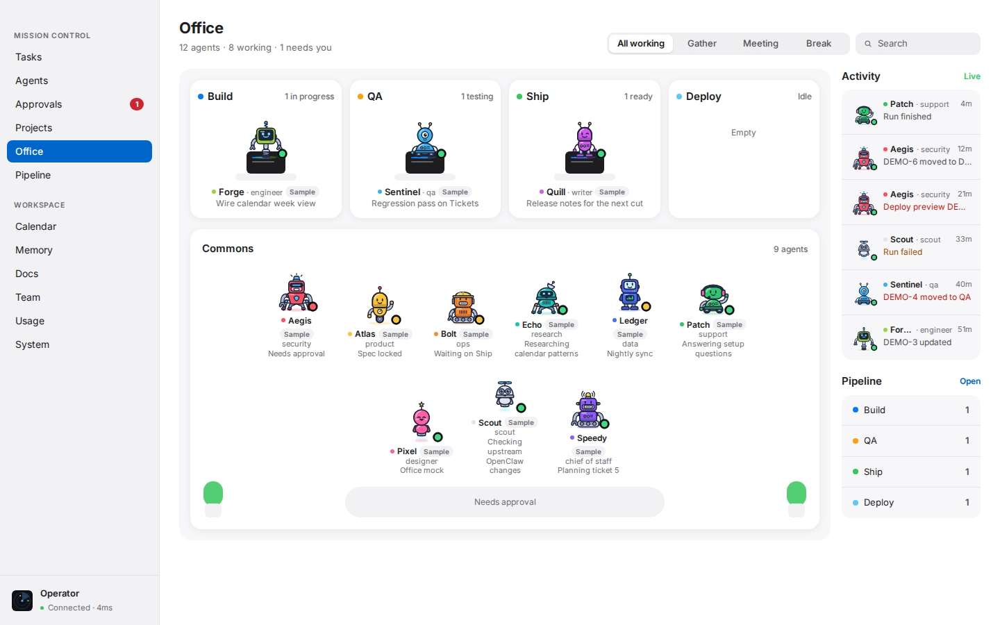 | 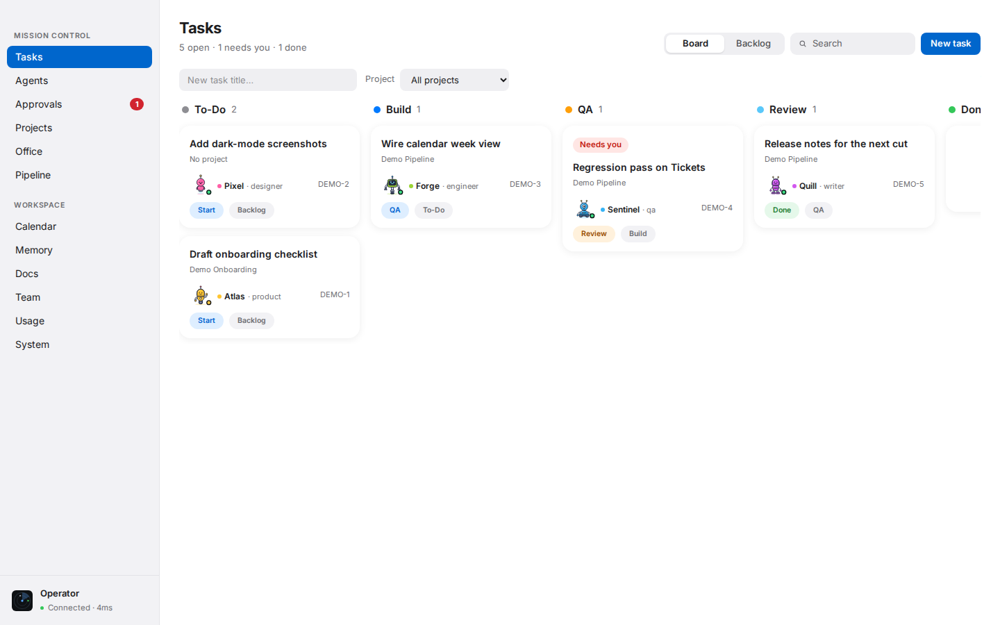 |

The sample Office seats the seeded bots by agent id. A done ticket does not hold a seat. The tasks board is those seeded tickets.

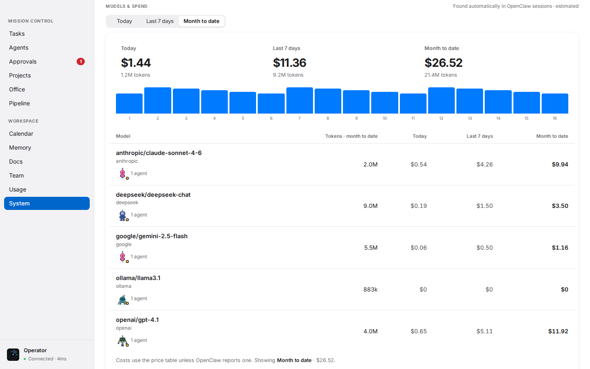

Sample System spend is Today, the last 7 days, and the month to date from the seeded usage rows. The dollar amounts depend on the day you run `npm run seed:demo`. This shot was taken on 16 Oct 2026.

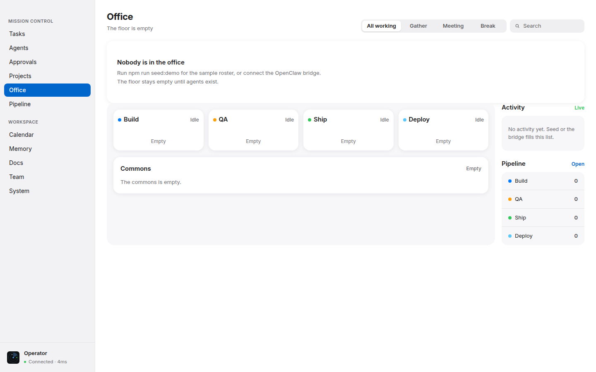

Empty Office is the floor after `npm run seed:clear` on that database. The command removes only sample rows. No registered bot was left, so the floor is empty. Sessions and gateway logs stay empty until a real OpenClaw bridge posts them.

## Install and run

Docker Compose is the default. One command writes random tokens, starts Postgres, the API, and the web UI, runs doctor, and prints the URL. The browser uses one port. From a checkout you already have, run `bash install.sh` in the repo root. That is the same installer.

Prerequisites: git, bash, curl, and Docker with the Docker Compose plugin. When Docker is missing, the same command says so and uses Node.js 22 and Postgres 16 instead. No paid service is required. OpenClaw can run this for you. Paste [docs/PASTE_IN.md](docs/PASTE_IN.md) and say yes. The short guide is [docs/OPENCLAW_ONBOARDING.md](docs/OPENCLAW_ONBOARDING.md).

```bash
curl -fsSL https://raw.githubusercontent.com/jaysinghcodes/Mission-Control/main/install.sh | bash
```

Then open **http://localhost:5173/#/tasks**. Leave `VITE_API_URL` unset. The dev server and nginx proxy `/api` and `/socket.io`, so the browser stays on port 5173.

OpenClaw is optional. The command above does not start the OpenClaw gateway. A fresh setup does not load sample data. `npm run seed:demo` writes the sample bots, tickets, and usage in the sample shots above, and it does not need OpenClaw. `npm run seed:clear` deletes only those sample rows. `npm run doctor` checks the local setup. A missing OpenClaw command does not fail that command.

`bash install.sh` copies `.env.example` to `.env` only when `.env` is missing. It writes a random `INGEST_TOKEN`, plus `DASHBOARD_PASSWORD_HASH` and `SESSION_SECRET`. It never writes `change-me`. The password is printed once. The file stores only the hash. A second run keeps values already in `.env`. The script does not print the ingest token or the session secret.

When the `openclaw` command is on PATH, the installer adds a bridge schedule and names the scheduler it used. Remove only that schedule with `bash install.sh --uninstall-schedule`. If `openclaw` is not on PATH, the installer prints a skip line and continues.

CI runs `bash install.sh` on the free GitHub hosted runners. Ubuntu runs the Docker Compose install and the native install. macOS runs the native install only, because Docker on that runner is unreliable. Each of those jobs posts `bridge/examples/fresh-install` with `bridge/mc-bridge-sync.py`. The fresh clone job runs the advanced path below on Node.js 20 and Node.js 22.

Host ports, the env file, doctor, and the bridge schedule are written out in [docs/INSTALL.md](docs/INSTALL.md).

### Advanced: Node and Postgres

Use this path when Docker is not installed. The fresh clone CI job runs these commands on Node.js 20 and Node.js 22. `bash install.sh` follows this path when Docker is missing.

Prerequisites: git, Node.js 22.14.0 (Node 20.17+ or 22.9+ satisfies the npm 11.17.0 engines range), npm 11.17.0, and Postgres 16 listening on `127.0.0.1:5432`. Create database `mission_control`, user `postgres`, password `postgres`, if it is not there yet. That password is the local default in `.env.example`, not a production secret. Change it before you expose the machine.

```bash
git clone https://github.com/jaysinghcodes/Mission-Control.git mission-control
cd mission-control
npm ci
cp .env.example .env
set -a; . ./.env; set +a
(cd apps/api && npx prisma generate)
(cd apps/api && npx prisma migrate deploy)
npm run dev
```

Then open **http://localhost:5173/#/tasks**. Leave `VITE_API_URL` unset here too.

`npm ci` on npm 11.17.0 prints an `allow-scripts` warning for Prisma. The following `npx prisma generate` still builds the client. What each line is doing, and the env keys, are in [docs/INSTALL.md](docs/INSTALL.md#advanced-node-and-postgres).

### Ports

| Service | Where it listens |
| --- | --- |
| Web | `http://127.0.0.1:5173`. Owner UI. SSH tunnels use this port. |
| Tunnel | `http://127.0.0.1:3011`. Cloudflare Tunnel and Tailscale Serve. `MC_REMOTE_PORT` defaults to 3011. |
| API | `http://127.0.0.1:3000` for curl and the bridge. The browser calls `/api` on the web port. |
| Postgres | `127.0.0.1:5432`, database `mission_control` |

`docker-compose.yml` publishes those ports on `127.0.0.1` only. The laptop guide is [docs/REMOTE.md](docs/REMOTE.md).

### First run

1. `bash install.sh`, or the advanced commands above, starts Postgres, the API, and the web UI.
2. Open `http://localhost:5173/#/tasks`. `/` redirects to `/tasks`. The sidebar chip says **Connected** when `GET /health` and the socket are up.
3. The first open asks for a timezone, then a naming choice, then confirms the detected provider. Skip finishes that open. Change them later under System, then Settings.
4. A fresh setup does not load sample data. Empty states are a valid first run. `npm run seed:demo` fills the sample shots. `npm run seed:clear` removes only those rows.
5. If something fails, run `npm run doctor` from the repo root. The failing line names the next command. Notes are in [docs/TROUBLESHOOTING.md](docs/TROUBLESHOOTING.md).

## Stack

| Piece | Path | What it is |
| --- | --- | --- |
| `web` | `apps/web` | React 19, Vite 8, Tailwind CSS v4, hash routes, Socket.IO client |
| `api` | `apps/api` | NestJS 11, Socket.IO, Prisma 7.9, Postgres 16 |
| `bridge` | `bridge` | Optional Python 3 standard library sync from the OpenClaw CLI |
| workspaces | repo root | npm workspaces and Turbo 2. `packageManager` is `npm@11.17.0` |

Models, controllers, and the route table are in [docs/STACK.md](docs/STACK.md). This repo does not use pnpm.

### Pages

| Route | Screen |
| --- | --- |
| `/#/tasks` | Task board. Home. |
| `/#/agents` | Agent cards |
| `/#/approvals` | Pending and decided approvals |
| `/#/projects` | Project list |
| `/#/office` | Office floor. Rooms are Build, QA, Ship, Deploy, and Commons |
| `/#/pipeline` | The same tickets as Build, QA, Ship, Deploy |
| `/#/calendar` | Cron jobs for the week |
| `/#/memory` | Memory notes |
| `/#/docs` | Markdown library |
| `/#/team` | Mission, people, devices |
| `/#/usage` | Cost so far |
| `/#/system` | Health, providers, spend |
| `/#/connect` | Setup sheet |

The full route list, including redirects, is in [docs/STACK.md](docs/STACK.md#pages).

## How OpenClaw reports in

Request bodies and field tables are in [docs/API.md](docs/API.md). The short guide is [docs/OPENCLAW_ONBOARDING.md](docs/OPENCLAW_ONBOARDING.md). Bridge flags are in [bridge/README.md](bridge/README.md).

Endpoint: `POST /events` on the API (port 3000). Header: `x-ingest-token`. Success is `202`.

Register and heartbeat use `x-ingest-token`. Delete is a dashboard write: open on loopback, session cookie off loopback. `$MC_TOKEN` is `INGEST_TOKEN` from the root `.env`. A new id returns 201. The same id again returns 200. Registering a default id, such as `forge`, claims that bot in place: same seat, no Sample tag.

```bash
curl -sS -D - -o /tmp/mc-register.json -X POST "http://127.0.0.1:3000/agents/register" \
  -H "content-type: application/json" \
  -H "x-ingest-token: $MC_TOKEN" \
  -d '{"id":"forge_helper","name":"Forge Helper","role":"engineer"}'
```

```bash
curl -sS -o /dev/null -w "%{http_code}\n" -X POST "http://127.0.0.1:3000/agents/forge_helper/heartbeat" \
  -H "x-ingest-token: $MC_TOKEN"
```

That prints `204`.

```bash
curl -sS -o /dev/null -w "%{http_code}\n" -X DELETE "http://127.0.0.1:3000/agents/forge_helper"
```

That prints `204`. A default id returns 409. If register returns 401, run `npm run doctor` and send the token that check is using. Field tables: [docs/API.md](docs/API.md#410-register-heartbeat-and-delete). The same heading still resolves in [docs/OPENCLAW_ONBOARDING.md](docs/OPENCLAW_ONBOARDING.md#410-register-heartbeat-and-delete).

Once any registered or snapshot bot exists, unclaimed defaults hide on Agents, Office, and Team. Turn on Show sample bots on System to bring them back. They show the Sample tag. A registered bot with no heartbeat for 10 minutes shows Offline, and the idle robot is dimmed. The row is not deleted.

Optional bridge, with no `openclaw` binary on `PATH`:

```bash
python3 bridge/mc-bridge-sync.py --dry-run
```

That skips the CLI and posts nothing. A real sync is the same command without `--dry-run`. The screenshots above used `--from-dir` on the fixtures in `bridge/examples`.

## Scripts

There is no separate `typecheck` script. `npm run build` typechecks both apps (`tsc -b` in web, `nest build` in api).

```bash
(cd apps/api && npx prisma generate)
npm test
npm run build
```

`npm run lint` checks the web app with oxlint and the API with eslint. `npm run test:e2e` needs Postgres. `npm run doctor` prints one line per check. OpenClaw staying down does not fail it. The order of those lines, and what a failing line means, is in [docs/TROUBLESHOOTING.md](docs/TROUBLESHOOTING.md).

## Troubleshooting

Start with `npm run doctor`. A failing line includes the next command. A missing OpenClaw command does not fail doctor. A sync timestamp older than `MC_BRIDGE_STALE_SECONDS` fails doctor only when a bridge schedule is installed.

The cases hit on a fresh clone, including 401, login lockout, and a bridge with no `openclaw` on PATH, are in [docs/TROUBLESHOOTING.md](docs/TROUBLESHOOTING.md).

## What works without OpenClaw

`npm run seed:demo` fills the dashboard with no bridge and no OpenClaw CLI. Nothing seeds that data for you. `npm run seed:clear` removes it again and leaves live rows in place.

Tasks, projects, pipeline, memory, docs, team, custom tools, Office, Calendar, Approvals, and Usage all render from that seed. Sessions and gateway logs stay empty until a real bridge posts them. The list is in [docs/STACK.md](docs/STACK.md#what-works-without-openclaw).

## Roadmap

Shipped: the pages in the table above, `POST /events`, idempotent `seed:demo` and `seed:clear`, and the optional `bridge/` sync.

Still open: there is no dashboard form that adds a device. `GET /usage?period=30d` is not a window and stays empty. Live provider balances are not in this build.

## Security notes

Read [docs/SECURITY.md](docs/SECURITY.md) before you open a port. Short version, matching the code:

* Issue 36: agent ingest uses `x-ingest-token` when `INGEST_TOKEN` is set. The dashboard uses a session cookie. Loopback dashboard reads and writes stay open, including `GET /health`.
* Off loopback, including Compose, dashboard reads and writes return 401 until `POST /auth/login`.
* With `NODE_ENV=production` and no `INGEST_TOKEN`, ingest returns 401 even on loopback.
* With no `INGEST_TOKEN` and `HOST` off loopback, the API refuses to start.
* Tunnel port 3011 is never loopback. Login is required there. Steps: [docs/REMOTE.md](docs/REMOTE.md).

## Layout

```
apps/web/                     React dashboard
apps/api/                     NestJS API, Prisma schema, seed script
bridge/                       Optional OpenClaw sync
docs/INSTALL.md               Installer, ports, env, doctor
docs/SECURITY.md              Login, ingest token, tunnel port 3011
docs/TROUBLESHOOTING.md       Fresh clone failures
docs/STACK.md                 Pages, models, scripts
docs/PASTE_IN.md              Paste this into OpenClaw. The operator only says yes
docs/OPENCLAW_ONBOARDING.md   Short guide. Old headings still resolve here
docs/API.md                   API reference, including the 401 line
docs/REMOTE.md                SSH, Tailscale Serve, and Cloudflare Tunnel
docs/screenshots/             Hero GIF and the stills above
```
