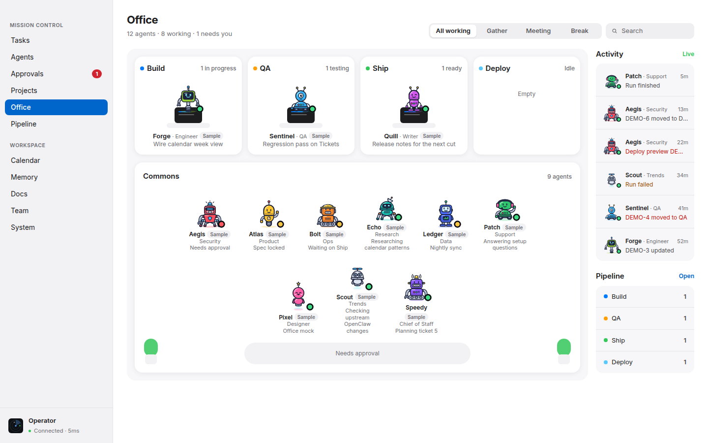
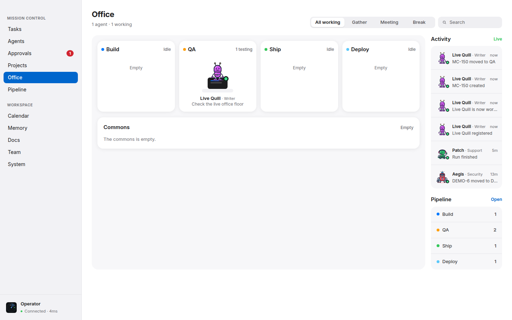
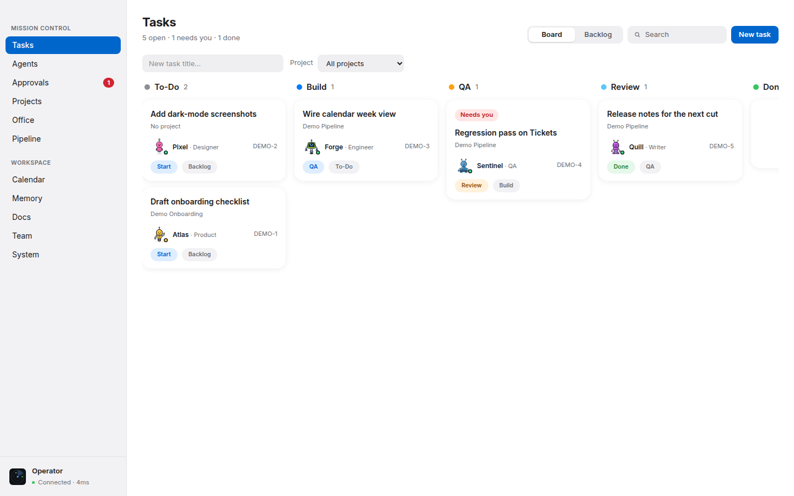
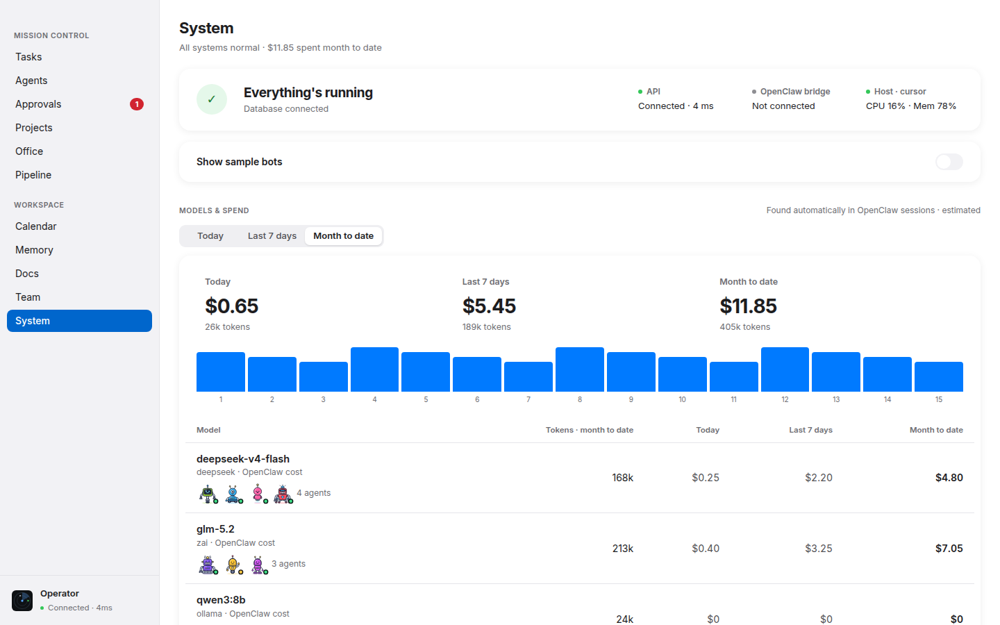

# Mission Control

You host this command center yourself. It is the dashboard for an OpenClaw setup, and it also runs with no OpenClaw at all. Home is the task board. Office is a full bleed floor with live rooms: Build, QA, Ship, Deploy, and a Commons. Sample bots, an empty floor, and one registered bot in a live room are all normal states. The rest of the sidebar is agents, approvals, projects, a pipeline, a calendar of cron jobs, memory, docs, a team page, and system health.

The sidebar order is Tasks, Agents, Approvals, Projects, Office, Pipeline, then Calendar, Memory, Docs, Team, System. Overview is not a route. `/` redirects to `/tasks`.

OpenClaw is optional. `npm run seed:demo` fills the sample roster so you can click through the UI. `npm run seed:clear` removes only those sample rows. `npm run doctor` checks the local setup. A missing OpenClaw bridge does not fail that command.

**OpenClaw agents start here:** paste [docs/PASTE_IN.md](docs/PASTE_IN.md) and say yes. That file runs the installer, reports the URL, then registers and sends a heartbeat. The short guide is [docs/OPENCLAW_ONBOARDING.md](docs/OPENCLAW_ONBOARDING.md). The API, including the 401 line, is [docs/API.md](docs/API.md). Every write route uses the `x-ingest-token` header when `INGEST_TOKEN` is set.

The web app uses hash routes. A page looks like `http://localhost:5173/#/tasks`. A path with no hash, such as `/tasks`, is not a client route.

Verified on a fresh clone with **Node v22.14.0** and **npm 11.17.0** (the `packageManager` field in `package.json`). This repo does not use pnpm. Postgres was **16.15**.

---

## Screenshots

These five shots are a live run of this branch, 1440 by 900, light theme. `npm run seed:demo` loads the sample bots. A fresh clone does not run that command, so the first Office is empty. `npm run seed:clear` returns to that empty floor. Registered bots and rows you created through the API stay.

The seeded bots are the sample roster. Office shows a Sample tag on those cards. System includes the Show sample bots switch. It stays off until you turn it on. Once a registered bot exists, the sample bots hide until you turn that switch on. A registered bot with no heartbeat for 10 minutes shows Offline, and the idle robot is dimmed.

| Office with sample bots | Office with one registered bot in QA |
| --- | --- |
|  |  |

| Tasks board | System usage |
| --- | --- |
|  |  |


The sample Office is the floor after `npm run seed:demo`. Each bot sits in the room its live ticket or run picks. A done ticket does not hold a seat. The QA shot is one registered bot, Live Quill, on a ticket in QA, with the sample bots hidden. The Tasks board is those seeded tickets. System shows Today, the last 7 days, and the month to date from the seeded usage rows. The dollar amounts depend on the date you run `npm run seed:demo`. The empty Office is the floor after `npm run seed:clear`. Sessions and gateway logs stay empty until a real OpenClaw bridge posts them.

---

## Install and run

Docker Compose is the default. One command writes random tokens, starts Postgres, the API, and the web UI, runs doctor, and prints the URL. The browser uses one port.

Prerequisites: git, bash, curl, and Docker with the Docker Compose plugin. When Docker is missing, the same command says so and uses Node.js 22 and Postgres 16 instead. OpenClaw can run this for you. Paste `docs/PASTE_IN.md` and say yes.

```bash
curl -fsSL https://raw.githubusercontent.com/jaysinghcodes/Mission-Control/main/install.sh | bash
```

From a checkout you already have, run `bash install.sh` in the repo root. That is the same installer. It clones into `./mission-control` when you use the one liner above.

Then open the URL the script prints. The default is **http://localhost:5173/#/tasks**.

`bash install.sh` copies `.env.example` to `.env` only when `.env` is missing. It writes `INGEST_TOKEN` and `SOCKET_TOKEN` as two different random values. It never writes `change-me`. A second run keeps tokens, secrets, and the other values already in `.env`. The script does not print the token values. It prints that they live in `.env`.

Host ports follow the shell, then `.env`, then the default. `MC_DB_PORT`, `MC_API_PORT`, and `MC_WEB_PORT` from the environment are written into a new `.env`. An existing `.env` keeps its port lines, except a shell `MC_DB_PORT` replaces that one line. A shell value still wins for that run. `DATABASE_URL` uses the resolved `MC_DB_PORT`, so `npm run seed:demo` on the host reaches Postgres. A later run with a different port updates `DATABASE_URL` and does not rotate tokens or secrets.

OpenClaw is optional. The command above does not start the OpenClaw gateway. `npm run seed:demo` writes the sample bots, tickets, and usage in the screenshots above. `npm run seed:clear` deletes only those sample rows. A fresh setup does not load sample data. `npm run seed:demo` does not need OpenClaw.

When the `openclaw` command is on PATH, `bash install.sh` installs a bridge schedule. Linux uses a systemd user timer, or cron when that user timer is not available. macOS uses launchd. The installer names the scheduler it used. The interval is `MC_BRIDGE_INTERVAL_SECONDS` from the shell, then `.env`, then 300. The job runs `bridge/mc-bridge-sync.py` and sets `MC_BRIDGE_REGISTER` from the shell, then `.env`, then 1. Its PATH includes the `openclaw` directory, the `python3` directory, and the PATH from install time, so a later run can find `openclaw`. Remove only that schedule with `bash install.sh --uninstall-schedule`. That flag also removes the sync timestamp. It does not stop Docker, does not delete `.env`, and does not change other cron lines or other service units. If `openclaw` is not on PATH, the installer prints a skip line and continues. A second run installs the same schedule again without duplicating it.

Doctor reads the sync timestamp at `MC_BRIDGE_STAMP_FILE` (default `bridge/.state/last-sync`). A missing timestamp is an info line. A timestamp older than `MC_BRIDGE_STALE_SECONDS` (default 600) is a failing line. A missing `openclaw` command is still an info line and does not by itself fail doctor. The installer also offers `bridge/openclaw.starter.json`. Merge that file into `~/.openclaw/openclaw.json` if you want it. The installer does not edit that file.

The API loads the root `.env` when that file is on disk, and it runs `prisma migrate deploy` before it listens. Compose injects `DATABASE_URL` for the `db` service, so the image does not contain a `.env` file. A variable that is already set wins over the file, including a blank value. The host `DATABASE_URL` is what `npm run seed:demo` uses. Its port is the resolved `MC_DB_PORT`.

nginx on the web port proxies `/api` and `/socket.io` to the API. The page and the live socket stay on port 5173. Leave `VITE_API_URL` unset. Set it only when the browser should call a different API origin, then rebuild the web image.

`docker compose logs api` should end with `mission-control api listening on 0.0.0.0:3000`. Data lives in the named volume `mc-db` and stays across `docker compose restart`.

The script ends by running doctor (`node scripts/doctor.mjs`). On the Docker path it first waits up to 90 seconds for the API health check on `MC_API_PORT` (default 3000). Doctor then checks that host port. The database and migration lines are info, because Compose runs Postgres and the API container applies migrations. A Docker install does not need `npm ci` for those checks. A missing OpenClaw command is an info line. A missing sync timestamp is an info line. A timestamp older than `MC_BRIDGE_STALE_SECONDS` fails doctor. If doctor prints a failing line, the script still prints the URL and then exits non zero.

Compose still has a blank token fallback (`dev-ingest-token` and `dev-socket-token`) for a manual copy of `.env.example`. `bash install.sh` writes real tokens first, so that fallback is not the installed path.

CI runs `bash install.sh` on Ubuntu and macOS with a docker stub. It does not boot Compose. The fresh clone job runs the advanced path below. The compose file, the nginx config, and the Dockerfiles are checked as text.

### Advanced: Node and Postgres

Use this path when Docker is not installed. The fresh clone CI job runs these commands.

Prerequisites that this run used: git, Node.js 22.14.0 (Node 20.17+ or 22.9+ satisfies the npm 11.17.0 engines range), npm 11.17.0, and Postgres 16 listening on `127.0.0.1:5432`.

Create the database the template expects if it is not there yet: database `mission_control`, user `postgres`, password `postgres`. That password is the local default in `.env.example`, not a production secret. Change it before you expose the machine.

```bash
git clone https://github.com/jaysinghcodes/Mission-Control.git mission-control
cd mission-control
npm ci
cp .env.example .env
set -a; . ./.env; set +a
(cd apps/api && npx prisma generate)
(cd apps/api && npx prisma migrate deploy)
npm run dev
```

Then open **http://localhost:5173/#/tasks**. The dev server proxies `/api` and `/socket.io`, so the browser still uses port 5173. Leave `VITE_API_URL` unset here too.

`npm ci` prints an `allow-scripts` warning for `@prisma/engines`, `prisma`, and `unrs-resolver` on npm 11.17.0. The following `npx prisma generate` still completed. `npx prisma migrate deploy` applies every folder in `apps/api/prisma/migrations`.

What each step is doing:

| Command | Why |
| --- | --- |
| `cp .env.example .env` | Root env file. The API loads it on boot. Compose reads the same file. |
| `set -a; . ./.env; set +a` | Vite and Turbo only see variables that are already in the environment. The dev proxy needs `INGEST_TOKEN` from this export. |
| `npx prisma generate` | Builds the Prisma client. Run it from `apps/api`. npm 11 does not do this during `npm ci`. |
| `npx prisma migrate deploy` | Applies `apps/api/prisma/migrations` before CI runs `npm test`. The API also runs this on boot. |
| `npm run dev` | Turbo starts the API (`nest start --watch`) and the web app (`vite`) together. |

Leave `GITHUB_TOKEN` empty unless you want pull request merge from Approvals. Do not commit `.env`. System probes the OpenClaw gateway at `OPENCLAW_GATEWAY_HOST` and `OPENCLAW_GATEWAY_PORT` (default `127.0.0.1` and `18789`). Gateway logs are read from `OPENCLAW_LOG_DIR` (default `/tmp/openclaw`).

`OPERATOR_NAME` is a display name, not a secret. Blank means the account chip says Operator. For `npm run dev`, also set `VITE_OPERATOR_NAME` to the same value if you want the browser bundle to see it. Vite only exposes `VITE_*` variables.

`TZ` is the server timezone when Settings has not saved one. `OFFLINE_AFTER_MS` is how long a registered bot can go without a heartbeat (default 600000, ten minutes). `HEALTH_TICK_MS` is the socket health interval (default 30000, and 0 turns it off). `USAGE_RETENTION_DAYS` is how many usage days a snapshot may keep (default 30). The same names are in `.env.example` and `apps/api/.env.example`.

### Ports

| Service | Where it listened |
| --- | --- |
| Web | `http://127.0.0.1:5173`. This is the UI port. `http://localhost:5173` also works when localhost resolves to that address. |
| API | Direct clients use `http://127.0.0.1:3000`. The browser does not. It calls `/api` on the web port. |
| Postgres | `127.0.0.1:5432`, database `mission_control` |

`docker-compose.yml` publishes those ports on `127.0.0.1` only (`MC_DB_PORT`, `MC_API_PORT`, `MC_WEB_PORT` override the host side). Inside Compose the API binds `0.0.0.0:3000` and nginx listens on `5173`. Moving `MC_API_PORT` does not change the browser unless you also set `VITE_API_URL`. `bash install.sh` writes the resolved `MC_DB_PORT` into `DATABASE_URL` for commands on the host. Compose still connects the API to `db:5432`.

### First run

1. `bash install.sh` starts Postgres, the API, and the web UI. `docker compose up -d --build` is the same Docker start when the tokens are already in `.env`. `npm run dev` is the advanced path and starts the API and the web app without Docker.
2. Open `http://localhost:5173/#/tasks`. `/` redirects to `/tasks`. The sidebar account chip says **Connected** plus the health latency when `GET /health` succeeds and the Socket.IO feed is up. **API only** means health is up and the socket is still reconnecting. **Offline** means the health probe failed.
3. If the first health probe fails, the shell sends the browser to `/#/connect`. Later failures do not keep redirecting.
4. `/#/connect` is an 8 step sheet: prerequisites, clone, root `.env`, start the stack, verify, OpenClaw bridge, SSH tunnel, smoke test. Progress is stored in this browser under `mc-setup-progress-v2`. Steps that say they probe health call `GET /health`. The other steps are marked done by the person at the keyboard. The last step returns to `/`, which lands on Tasks.
5. `/#/` goes to Tasks. Health lives on `/#/system`. Trust the sidebar chip.
6. The first open asks for a timezone, then whether to use the Mission Control crew or keep each agent's own name, then confirms the detected provider. Skip finishes that open. Each choice is saved on the settings row. Change them later under System, then Settings. Office uses the naming choice as soon as it is saved. `npm run seed:demo` does not finish setup and does not choose names. Crew names come from `config/crew.json` and apply only by the agent id you save. Usage and memory count days in the saved timezone. The names are `config/timezones.json`. A legacy name such as `Asia/Calcutta` is saved as its current name. With no saved timezone, that is `TZ` when that name is in the list, otherwise the host zone.

A fresh setup does not load sample data. `npm run dev` after migrate shows empty states. That is a valid first run, not a crash.

`npm run seed:demo` is what fills the screenshots. It writes sample agents, cron jobs, tickets, projects, runs, activity, approvals, memories, docs, devices, usage, a mission line, and one custom tool. It is idempotent. It refuses to run when `NODE_ENV=production` unless `SEED_DEMO_ALLOW_PROD=1`.

`npm run seed:clear` deletes only those sample rows. It matches the seeded ids, or the usage marker on a day nothing has overwritten. Registered bots, snapshot rows, and rows you created through the API stay. A mission you edited stays. A doc you edited stays. It is idempotent. Running it twice exits 0 both times. The same production guard applies.

---

## Stack

| Piece | Path | What it is |
| --- | --- | --- |
| `web` | `apps/web` | React 19, Vite 8, Tailwind CSS v4, React Router hash routes, Socket.IO client |
| `api` | `apps/api` | NestJS 11, Socket.IO, Prisma 7.9, Postgres 16 |
| `bridge` | `bridge` | Optional Python 3 standard library sync from the OpenClaw CLI |
| workspaces | repo root | npm workspaces and Turbo 2. `packageManager` is `npm@11.17.0` |

Prisma models, 14 counted in `apps/api/prisma/schema.prisma`: `Agent`, `Run`, `Project`, `Ticket`, `Session`, `CronJob`, `UsageBucket`, `ActivityEvent`, `Approval`, `MemoryEntry`, `ModelConfig`, `Setting`, `Device`, `CustomTool`.

The API has 21 controllers (`@Controller` in `apps/api/src`). `team.controller.ts` registers two of them, `mission` and `devices`. The others are sessions, runs, activity, logs, calendar, models, approvals, custom tools, projects, search, usage, events, tickets, docs, health, memory, agents, the root app controller, and system.

Schema changes stay human reviewed. On boot the API runs `prisma migrate deploy`, which applies those reviewed migrations. It does not create new ones. That includes `npm run dev` and `node dist/main.js`.

### Pages

| Route | Screen |
| --- | --- |
| `/#/tasks` | Task board. Home. |
| `/#/tasks?view=backlog` | Backlog list for the same tickets |
| `/#/agents` | Agent cards |
| `/#/approvals` | Pending and decided approvals |
| `/#/projects` | Project list |
| `/#/projects/<id>` | One project and its tickets |
| `/#/office` | Full bleed Office. Live rooms are Build, QA, Ship, Deploy, and Commons |
| `/#/pipeline` | The same tickets as Build, QA, Ship, Deploy |
| `/#/calendar` | Cron jobs for the week |
| `/#/memory` | Memory notes |
| `/#/usage` | Cost so far, by day, bot, and model |
| `/#/docs` | Markdown library from `DOCS_ROOT` |
| `/#/team` | Mission, people, devices |
| `/#/system` | Health, provider and model per agent, versions, spend, links to the panels below |
| `/#/system/logs` | Gateway log tail, or an empty state |
| `/#/system/sessions` | Sessions from `sessions.snapshot` |
| `/#/system/settings` | Connection and log out |
| `/#/system/connection` | How this browser reaches the API |
| `/#/system/tools` | Experimental custom tools |
| `/#/connect` | Setup sheet (no sidebar) |

These paths are redirects, not pages: `/tickets` to `/tasks`, `/backlog` to `/tasks?view=backlog`, `/factory` and `/activity` to `/office`, `/health` to `/system`, `/logs` to `/system/logs`, `/sessions` to `/system/sessions`, `/settings` to `/system/settings`. The URL table above lists only routes that render a screen.

---

## How OpenClaw reports in

Full request bodies, field tables, and the heartbeat rules are in [docs/API.md](docs/API.md). The short guide is [docs/OPENCLAW_ONBOARDING.md](docs/OPENCLAW_ONBOARDING.md). Short version, matching the code:

* Endpoint: `POST /events` on the API (port 3000).
* Header: `x-ingest-token: <INGEST_TOKEN>` where `<INGEST_TOKEN>` equals `INGEST_TOKEN` in the root `.env`. The same header is required on every `POST`, `PUT`, `PATCH`, and `DELETE` when that variable is set, not only on `POST /events`.
* Body: `{ "type": "<one of KNOWN_TYPES>", "payload": { } }`. The list lives in `apps/api/src/ingest/ingest.controller.ts`.
* Success is `202` with `{ "accepted": true, "type", "ts" }`.
* Snapshot types replace or upsert tables: `agents.snapshot`, `sessions.snapshot`, `calendar.snapshot`, `usage.snapshot`, `approvals.snapshot`, `memory.snapshot`, and `models.snapshot`. Handlers are in `apps/api/src/snapshots/snapshots.service.ts`.
* `memory.snapshot` upserts notes by id and drops bridge sourced rows for the agents in the payload when those ids are missing. An empty `entries` list is a no op. It does not wipe Memory. Demo rows stay.
* `agents.snapshot` creates, updates, or removes snapshot rows only. Default and registered bots stay. `POST /agents/register` upserts one bot (201 when new, 200 when the id exists). `POST /agents/:id/heartbeat` returns 204 and sets `lastSeenAt`. An optional JSON body may set `currentTask` and `status` (`working` or `idle`). No body leaves those fields unchanged. `status` `idle`, JSON null, or a blank `currentTask` clears `currentTask` and sets status to idle. `DELETE /agents/:id` returns 204 for a registered bot and 409 for a default or a snapshot row. An open Agents, Office, or Team page refetches within 2 seconds. Details: [docs/API.md](docs/API.md#410-register-heartbeat-and-delete). The same heading still resolves in [docs/OPENCLAW_ONBOARDING.md](docs/OPENCLAW_ONBOARDING.md#410-register-heartbeat-and-delete).
* `usage.snapshot` stores daily points (`points: [{ at, totalCost?, tokensIn?, tokensOut?, providers?: [{ bot?, provider?, model?, tokensIn?, tokensOut?, costUsd?, local? }] }]`). The bridge does not post a separate 7 day or month total. `GET /usage?period=24h|7d|month` prices those points. `period=24h` is Today, the calendar day in the timezone saved in Settings, taken from the daily buckets. When none is saved, that is `TZ` when that name is in `config/timezones.json`, otherwise the host zone. There is no hourly storage. The 7 day and month windows, Memory, and Calendar use that same timezone. A short range includes `note`, for example `Showing 3 days of data so far`, and does not fill missing days with zero. Cost is tokens times `config/prices.json` (USD per one million tokens). `config/prices.local.json` is gitignored and merged on top at each read, so an edit changes totals without a rebuild. A provider `costUsd` wins when it is present, including 0. Ollama and any provider marked local are $0.00. A model with no price shows its tokens and the exact label `Price not set`. `npm run seed:demo` writes 30 days of tokens and stores no dollars. `period=30d` is not a window and returns `usage: null`. A point older than `USAGE_RETENTION_DAYS` (default 30) before today, or a point after now, is not stored. If OpenClaw sessions have no timestamps, the bridge records only the days it has synced. Live provider balances are not read.
* `GET /models` returns `{ models }` from the latest `models.snapshot`. The bridge reads `~/.openclaw/openclaw.json` (`OPENCLAW_CONFIG_PATH` overrides that path). When that file has no agent model, it falls back to `openclaw models list`. Each row is the provider and model for one agent. An empty list is the System sentence "No providers found yet. Run the bridge to detect them." `POST /models` and `DELETE /models/:id` still use the write token. They do not call a provider. The next snapshot replaces the table. `GET /health` adds `version` from `apps/api/package.json`, `gitSha`, and `openclawVersion`. `GET /system` includes `gateway.up` from a TCP connect to the configured gateway.
* `run.*` events are activity and a socket broadcast. They do not insert tickets or runs. Office refetches tickets, runs, and activity when those events arrive, then places each bot from the shared live state (an active ticket in build, qa, or review, then an active run, then heartbeat). A done ticket does not seat its bot. Deploy seats a bot only for an active run on a done ticket when no higher precedence ticket applies. A register or delete also refetches activity. Role text is not a seat.
* The board is `POST /tickets` and `PATCH /tickets/:id`. A run row is `POST /runs` (201) and `PATCH /runs/:id` (200). Optional `ticketId` on those run calls stores `Run.ticketId` when the ticket exists. An unknown `ticketId` is 404 and does not write the row. The bridge retries that 404 once without `ticketId` so the run is still recorded. Those routes require `x-ingest-token` when `INGEST_TOKEN` is set. A missing run name is 400 and the message names `name`. A name longer than 200 characters, or an agent longer than 100, is 400 and the message names that field. Optional `status` on create defaults to `queued`. Accepted values are `queued`, `running`, `done`, `failed`, and `needs_approval`. A bad `status` is 400 and the message names `status`. Any other field the route does not accept is 400. A PATCH that changes nothing returns 200 with the same run and writes no activity event. An unknown run id is 404. Success bodies have no `error` key.
* The office floor has no endpoint. It reads agents, tickets, runs, approvals, and activity. Agents, Team, and Office share that placement. The rules are in [docs/API.md](docs/API.md#3-what-each-screen-shows). The same heading still resolves in [docs/OPENCLAW_ONBOARDING.md](docs/OPENCLAW_ONBOARDING.md#3-what-each-screen-shows).
* The server broadcasts its own `health.tick` on the socket about every 30 seconds. A client can also POST `health.tick`. The System bridge chip follows the newest activity row with source `openclaw`.

Register, heartbeat, and delete use the same header. `$MC_TOKEN` is `INGEST_TOKEN` from the root `.env`. A new id returns 201. The same id again returns 200 and does not add a second row. Registering a default id, such as `forge`, claims that bot in place: same seat, no Sample tag.

```bash
curl -sS -D - -o /tmp/mc-register.json -X POST "http://127.0.0.1:3000/agents/register" \
  -H "content-type: application/json" \
  -H "x-ingest-token: $MC_TOKEN" \
  -d '{"id":"forge_helper","name":"Forge Helper","role":"engineer"}'
```

```bash
curl -sS -o /dev/null -w "%{http_code}\n" -X POST "http://127.0.0.1:3000/agents/forge_helper/heartbeat" \
  -H "x-ingest-token: $MC_TOKEN"
```

That prints `204`.

```bash
curl -sS -o /dev/null -w "%{http_code}\n" -X DELETE "http://127.0.0.1:3000/agents/forge_helper" \
  -H "x-ingest-token: $MC_TOKEN"
```

That prints `204`. A default id returns 409. If register returns 401, run `npm run doctor` and send the token that check is using.

Once any registered or snapshot bot exists, unclaimed defaults hide on Agents, Office, and Team. The rows stay in the database. Turn on Show sample bots on System to bring them back. They show the Sample tag. The switch is saved in this browser and stays on after a reload. Delete every real bot and the defaults show again on their own. A bridge snapshot never removes a registered bot.

A registered bot with no heartbeat for 10 minutes shows Offline. The label uses the existing idle robot, dimmed. The row is not deleted.

Example that returned `202` against the running API (token redacted):

```bash
curl -sS -X POST "http://127.0.0.1:3000/events" \
  -H "content-type: application/json" \
  -H "x-ingest-token: <INGEST_TOKEN>" \
  -d '{"type":"health.tick","payload":{"uptimeSeconds":1,"connectedClients":0}}'
```

Roster example, the object the ingest tests persist (a partial snapshot removes other snapshot rows and leaves default and registered bots):

```json
{
  "type": "agents.snapshot",
  "payload": {
    "agents": [
      {
        "name": "Nova",
        "color": "#4DD0E1",
        "role": "development",
        "status": "working",
        "emoji": "🔧",
        "personalityTags": ["builder", "daily"],
        "currentTask": "MC-200 agent data model",
        "tasksCompleted": 42,
        "totalCost": 12.4,
        "recentActivity": "merged PR #11",
        "channel": "#development"
      }
    ]
  }
}
```

Optional bridge, from this repo, with no `openclaw` binary on `PATH`:

```bash
python3 bridge/mc-bridge-sync.py --dry-run
```

That exited 0 and printed that it was skipping sessions, agents, and cron, and posting nothing. A real sync is the same command without `--dry-run`, after `openclaw` is installed and `INGEST_TOKEN` is set. Details: [bridge/README.md](bridge/README.md).

---

## Scripts

There is no separate `typecheck` script. `npm run build` typechecks both apps (`tsc -b` in web, `nest build` in api).

Generate the Prisma client first. npm 11.17.0 does not run the Prisma install scripts, so `npm test` and `npm run build` cannot see `.prisma/client` until you do:

```bash
(cd apps/api && npx prisma generate)
npm test
npm run build
```

`npm run doctor` prints one line per check, in this order: Node, the API port, `.env`, the database, migrations, the write token, API health, an info line for the optional OpenClaw command, then the bridge sync age. The native path uses `PORT` (default 3000). When the Compose API service is running, the port check uses `MC_API_PORT` (default 3000) and the database and migration lines are info. It does not check the web port 5173. OpenClaw staying down does not fail the command. A sync timestamp older than `MC_BRIDGE_STALE_SECONDS` does. Run it from the repo root when setup fails, or after `npm run dev` is up.

On this clone, after that generate, `npm test` passed (API Jest: 37 suites, 255 tests; web: 65 tests) and `npm run build` passed. This pass used Node 22.23.3. Six of the nine tests in `apps/api/src/ingest/ingest.controller.spec.ts` need Postgres. With Postgres unreachable, that file is the only API failure: 6 failed, 249 passed, 255 total. The unknown event type check and the production missing token checks (`POST /events` and `POST /tickets` with no token) return before they write. The write route coverage tests do not need Postgres. Web tests do not use Postgres.

`npm run lint` checks the web app with oxlint and the API with eslint. It only reads files. `npm run lint:fix` runs the same checks and applies their automatic fixes. Commit the result only after you review the diff. `npm run test:e2e` needs Postgres.

---

## Troubleshooting

These are the failures hit while bringing up a fresh clone. Commands were run from the repo root unless noted.

**Start with `npm run doctor`.** It prints one line per check. A failing line includes the command to run next. OpenClaw is optional in that report. A missing command does not fail doctor. A sync timestamp older than `MC_BRIDGE_STALE_SECONDS` does. The command exits 0 when every required check passes, and exits non zero when one does not.

**Doctor says the last OpenClaw sync is older than the limit.** A bridge schedule is installed and the last successful sync is older than `MC_BRIDGE_STALE_SECONDS`. Run `python3 bridge/mc-bridge-sync.py` once, or run `bash install.sh` again. If no schedule is installed, that same age is an info line. `bash install.sh --uninstall-schedule` removes the schedule and the sync timestamp.

**The dev server listens on `127.0.0.1:5173`.** Vite `server.host` is `127.0.0.1`. The tunnel `ssh -L 5173:127.0.0.1:5173 -L 3000:127.0.0.1:3000` forwards to that address. Open `http://127.0.0.1:5173/#/tasks` on the machine that opened the tunnel. On the advanced path the API, with `HOST=127.0.0.1`, listens on `127.0.0.1:3000`. The browser calls `/api` on port 5173 either way. `http://localhost:3000` still reaches the API directly when localhost resolves to IPv4.

**Sidebar says Offline and the browser lands on `/#/connect`.** The first `GET /health` failed. The API is not up, or `VITE_API_URL` points at a different host. Leave `VITE_API_URL` unset so the page calls `/api` on its own origin. Start the stack with `bash install.sh` or `docker compose up -d --build`, or on the advanced path export `.env` and run `npm run dev`. A later health failure does not redirect again.

**A write returns 401 `unauthorized`.** `INGEST_TOKEN` is set (the template ships `change-me`) and the `x-ingest-token` header is missing or different. This is every `POST`, `PUT`, `PATCH`, and `DELETE`, including `POST /events` and `POST /tickets`. The body is `{"statusCode":401,"message":"unauthorized"}`. Send the same value the API process has. A wrong token failed the same way. Reads such as `GET /health` do not check the header.

**`POST /events` returns 400 unknown event type.** `type` is not in `KNOWN_TYPES`. The response body lists the allowed names.

**`POST /events` returns 400 `payload must be a JSON object`.** `payload` was an array or some other non object. Omit it or send `{}`.

**`POST /tickets` returns 400 `title is required`.** The title was missing or blank. Create status must be `backlog` or `todo` if you send one.

**`npm ci` warns that install scripts are not covered by allowScripts.** Seen for `@prisma/engines`, `prisma`, and `unrs-resolver` on npm 11.17.0. Until `(cd apps/api && npx prisma generate)`, `npm test` and `npm run build` fail with `Cannot find module '.prisma/client/default'`. Generate succeeded after the warning. If generate cannot find query engines, allow those scripts (`npm approve-scripts` in the npm 11 docs) and generate again.

**`npm run lint` exits 1.** oxlint or eslint found an error. The command does not rewrite files. Run `npm run lint:fix` for the automatic fixes, then fix anything it still reports.

**`python3 bridge/mc-bridge-sync.py` says `openclaw` is not on PATH and posts nothing.** Expected on a machine without the OpenClaw CLI. Exit code was 0. Demo data stays. Install the CLI, or POST `/events` yourself using the onboarding file.

**Setup sheet.** The current home is `/#/tasks`. Open `/#/system` for health. The Connected chip is in the sidebar under the account name.

---

## What works without OpenClaw

`npm run seed:demo` fills the dashboard with no bridge and no OpenClaw CLI. Nothing seeds that data for you. `npm run seed:clear` removes it again and leaves live rows in place.

* Tasks and the backlog view, from seeded tickets.
* Projects, including ticket counts, from seeded projects.
* Pipeline, the same tickets as Build, QA, Ship, Deploy.
* Memory notes, from seeded rows. Docs do not use the bridge. The seed writes sample markdown under `data/docs`.
* Team mission, from `GET /mission`. People come from the seeded roster and show a Sample tag until a real bot is registered. Devices come from the seed. There is no device write route.
* Custom tools, one seeded tool on `/#/system/tools`.
* Office, Calendar, Approvals, and Usage for Today, the last 7 days, and the month. The seed writes 30 days of tokens. Dollars are computed on read from `config/prices.json`.

Sessions and gateway logs stay empty until a real bridge posts them.

## Roadmap

What this tree already does:

* ✅ Tasks, Agents, Approvals, Projects, Office, Pipeline
* ✅ Calendar, Memory, Docs, Usage, Team (mission, people, devices), System
* ✅ System panels for logs, sessions, settings, connection, and custom tools
* ✅ `POST /events` intake, including `memory.snapshot` and `usage.snapshot` daily points (Today, 7 day, and month are summed on read)
* ✅ Idempotent `seed:demo` and `seed:clear`. A fresh setup does not load sample data.
* ✅ Optional `bridge/` sync from the OpenClaw CLI

Still open:

* Devices have no write route.
* `GET /usage?period=30d` stays empty. That query is not a window.
* Live provider balances are not in this build.

## Security notes

Read this before you open a port.

* When `INGEST_TOKEN` is set, every write requires header `x-ingest-token`. That is `POST`, `PUT`, `PATCH`, and `DELETE`: `POST /events`, `POST /tickets`, `PATCH /tickets/:id`, `POST /projects`, `PATCH /projects/:id`, `POST /runs`, `PATCH /runs/:id`, `PUT /mission`, `POST /approvals/:id/decide`, `POST /models`, `DELETE /models/:id`, `POST /agents/register`, `POST /agents/:id/heartbeat`, `DELETE /agents/:id`, and the custom tool writes. A missing or wrong token is 401 JSON `{"statusCode":401,"message":"unauthorized"}`. Reads do not check the token.
* With no `INGEST_TOKEN` and `HOST` on loopback (`127.0.0.1` by default for `npm run dev`), writes stay open and the API logs one warning, for any `NODE_ENV` other than `production`. The web UI still works.
* With `NODE_ENV=production` and no `INGEST_TOKEN`, the API still starts on loopback and logs one line that shows how to set `INGEST_TOKEN`. Every write returns 401, including `POST /events`.
* With no `INGEST_TOKEN` and `HOST` on any other address, the API refuses to start. Set `INGEST_TOKEN` to a long random string (`openssl rand -hex 24`) and start again. Compose sets `HOST=0.0.0.0` inside the api container, so it always has a token: your `.env` value, or `dev-ingest-token` when that value is blank. `bash install.sh` writes a random token into `.env` before Compose starts, so a fresh install does not use `dev-ingest-token`.
* The browser never receives the token. Dev Vite and compose nginx add `x-ingest-token` on same origin `/api` writes. Do not put `INGEST_TOKEN` in a `VITE_` variable or in local storage. `npm run seed:demo` writes through Prisma and does not send the header. The bridge still posts `POST /events` with the header.
* Do not publish port 3000 beyond loopback without a token. `npm run dev` binds `127.0.0.1` (`HOST` in the root `.env`). Compose publishes the API on `127.0.0.1` as well.
* `POST /agents/register` adds one bot without replacing the roster. `agents.snapshot` removes only snapshot rows that the payload omits. Default and registered bots stay. A registered bot with no heartbeat for 10 minutes reads `online: false` and is not deleted. The screen shows Offline and dims the idle robot. Unclaimed sample bots hide once a real bot exists until Show sample bots is on.

## Layout

```
apps/web/                  React dashboard
apps/api/                  NestJS API, Prisma schema, seed script
bridge/                    Optional OpenClaw sync
docs/PASTE_IN.md              Paste this into OpenClaw. The operator only says yes
docs/OPENCLAW_ONBOARDING.md   Short guide. Old headings still resolve here
docs/API.md                   API reference, including the 401 line
docs/screenshots/          Live screenshots embedded above
wireframes/                Static wireframe art, not the running UI
LOG.md                     Change log
ONBOARDING.md              Human install steps for an agent to walk through
```

The running UI is `apps/web`. `wireframes/` is the drawing set. `design/` is older reference art and is not the screenshot source.
